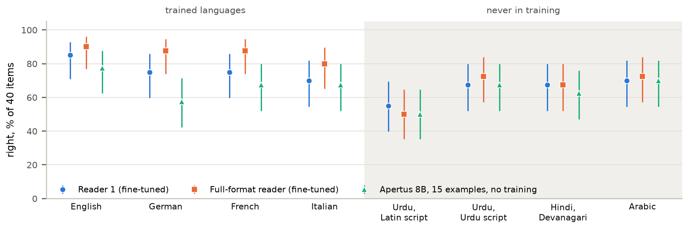

# Results overview — every result of the four rounds, what it means, and what it does not show

> Written 13 October 2026 for the owner's review. Every number is copied from the results file
> named next to its table; nothing here was computed afresh. The technical report
> (`technical_report.md`) is the six-page version of this; `docs/report_rounds_1_2.md` the long
> account of the first two rounds; `results/tables/phase3.md` the rendered tables of rounds three
> and four; `docs/decisions.md` the log of every deviation and its cost.

## Terms used throughout

- **Lightpath provisioning:** for each connection request (source, destination, bit rate) the
  controller picks a route among candidate paths and a block of spectrum slots on it, or rejects
  the request. The simulator is the Optical Networking Gym, preset `jocn_benchmark`: the
  nobel-eu network of 28 nodes and 41 links, five candidate paths per request, 320 slots.
- **Erlang (E):** the offered load, arrivals per unit time times holding time. 240 E is a quiet
  network, 390 E a busy one, 600 E on the Swiss network a busy one for its size.
- **Blocking:** the share of requests rejected for lack of spectrum. **Violation:** a decision
  that breaks the operator's instruction (a route through a link told to be avoided, a candidate
  taken when the instruction excluded it). **Complies:** the decision lies in the set of paths
  the instruction allows; when none is allowed, only a reject complies.
- **Closed loop:** the policy decides every request of a live simulated stream and its decisions
  change the network state the next requests see. **Offline (probe):** the policy answers a
  fixed set of request snapshots; nothing is applied.
- **First fit:** the instruction-blind baseline that takes the first candidate path with free
  spectrum. **Teacher:** a rule that ignores the instruction and picks by load or hops.
  **Oracle / true table:** the decision with the instruction known exactly.
- **Decider:** Apertus 8B fine-tuned to answer each request directly (`path=1 slot=120` or
  `reject`). **Reader (translator):** Apertus 8B fine-tuned to turn the instruction once into one
  line of a small policy language, which a rule engine then enforces. **Hybrid:** the reader
  first, the decider for what the reader marks as outside the language, with a **guard** that
  replaces a decider's choice if it breaks the part the line does carry.
- **LoRA / QLoRA:** fine-tuning that trains small added matrices (rank 32 here, 79.7 M parameters)
  on top of a frozen base; QLoRA keeps the base in 4-bit precision while training. An **adapter**
  is the trained addition, 160 MB each.
- **Grammar-constrained decoding:** the model may only produce tokens that keep the output a
  valid line of the policy language (node names from the topology, slots in order). **Greedy:**
  the most likely token each step. **Temperature 0.8:** sampling with randomness, used here only
  to get varied readings for the self-consistency check.
- **Held-out:** clause combinations (pairs, triples) or instruction types fixed before testing and
  never present in training. **Blind:** test sentences written by separate AI instances that saw
  neither the repository nor our wording.
- **GGUF, 4-bit, llama.cpp:** the file format and runtime used on the laptop (RTX 4060, 8 GB);
  the base is quantised to 4 bits, each adapter travels as its own GGUF file.

## 1. What was built

Apertus 8B reads an operator's policy sentence, in any of four languages, into one line of a
policy language. A rule engine enforces that line for every request the policy covers, for as
long as it holds; the line is also a TAPI 2.1.3 constraint, the object a transport SDN controller
takes. A second reader reads the sentence again and the operator is asked when a request would be
decided differently under the two readings. Instructions outside the language go to a fine-tuned
decider with a guard. A policy table holds standing policies with scope and lifetime, names
conflicts and reports per policy. An operator console shows the network on a map, reads back each
reading, previews its effect on a copy of the network, and keeps an audit trail per lightpath.
Everything runs on a laptop GPU.

Four adapters were trained on one rented A100 (Hugging Face Jobs): the decider on 12,000
simulator decisions (138 min), two readers of the third format on 5,570 instructions each (34 min
each), one reader of the fourth format (scope and lifetime) on 7,170 (65 min). Total 17.3
GPU-hours, about USD 43.18 of 45 (`docs/decisions.md`, budget rows).

## 2. Rounds one and two: the decider, and translate against decide

**Decider, closed loop** (`results/eval/*.json` of the second pass; 390 E, three seeds,
violations % of requests; `docs/report_rounds_1_2.md` section 5):

| Policy | Avoid link | Fewest hops | Least loaded | Fewest slots | Unseen wording | Unseen pairs |
| --- | --- | --- | --- | --- | --- | --- |
| First fit (ignores intents) | 24.5 | 10.4 | 43.2 | 0.1 | 19.3 | 33.9 |
| MLP control (small classifier, no language model) | 0.8 | 2.7 | 11.4 | 0.1 | 3.2 | 24.9 |
| Apertus 8B, no fine-tuning | 28.1 | 10.2 | 42.1 | 0.1 | 19.2 | 32.6 |
| Apertus 8B fine-tuned, second pass | 3.3 | 0.6 | 0.7 | 0.1 | 1.0 | 12.9 |
| Apertus 8B fine-tuned, first pass | 17.5 | 0.5 | 1.5 | 0.1 | 3.4 | 20.4 |

What it shows: fine-tuning is what makes the model follow an intent at all (the untrained model
is first fit with extra invalid answers); the second pass, which taught avoid-link pairs as
filter-then-rank, fixed the first pass's avoid-link weakness. Offline compliance of the second
pass: 98.9 % on new traffic, 98.7 % on unseen wording, 85.8 % on unseen pairs (the MLP control
97.3 / 96.3 / 72.5). The open weakness is composition: two intents never seen together cost the
decider 12.9 % violations.

**Translate or decide** (`results/tables/phase1.md`; closed loop, 390 E, violations %):

| Where the model sits | Avoid link | Fewest hops | Least loaded | Fewest slots | Unseen wording | Unseen pairs |
| --- | --- | --- | --- | --- | --- | --- |
| Decides every request, fine-tuned | 3.27 | 0.63 | 0.67 | 0.13 | 1.03 | 12.88 |
| Translates once, fine-tuned | 0.00 | 0.00 | 0.00 | 0.00 | 0.00 | 2.77 |
| Translates, 7 examples, no training | 0.03 | 0.00 | 10.58 | 0.00 | 3.50 | 4.17 |
| Keyword parser, no model | 0.00 | 0.00 | 0.00 | 0.00 | 11.33 | 0.00 |

Right meaning on harder sets (independent wording, native German, French, Italian, Swiss German,
misspelt cities, another topology): the fine-tuned translator 97.5 / 96.6 / 98.4 / 97.5 / 95.3 /
95.5 / 98.9 %, the decider 91.3 / 89.6 / 92.0 / 90.9 / 85.3 / 89.8 / 92.3 %, a keyword parser
87.5 / 74.5 / 73.4 / 70.1 / 72.5 / 79.0 / 95.7 %. What it shows: the model reads better than it
decides, and a rule engine with a correct line cannot violate; the parser fails on anything but
the trained wording. This decided the architecture: translate first.

**Second translator and the first hybrid** (round two): the second translator reads 95.0 % of
independently worded and 96.6 / 94.5 / 98.0 % of native German / French / Italian instructions,
86.4 % with two preferences (first translator 41.6 %); closed loop 0.20 % violations on pairs
(first 2.77 %). The decider follows three instruction types it was never trained on (pass through
a node 94.0 %, avoid a node 83.5 %, a given candidate 84.0 % compliance, where first fit gives
16.5 / 32.5 / 11.5) and is no better than the shortest candidate on hop or length limits. On a
mixed stream the hybrid breaks 4.0 % of requests, the translator alone 9.3 %, the decider alone
6.3 %, first fit 19.4 %. What it shows: the decider is worth keeping as the fallback for what the
language does not carry.

## 3. Round three: a policy language, two readers, a guarded fallback, the laptop

Third answer format: `avoid=…; via=…; hops=…; km=…; path=…; prefer=…; rest=…`. Test sentences:
168 per language from four separate AI instances. Held-out combinations fixed and committed before
the sentences were opened (`7ab1e66`).

**Reader 1 by composition and the decider's compliance** (`results/offline/*_probes3.json`,
672 English requests):

| | One clause | Pair seen | Pair never seen | Three clauses, never seen | All |
| --- | --- | --- | --- | --- | --- |
| Reader 1, right meaning, % | 94.6 | 95.6 | 96.5 | 91.2 | 94.8 |
| Apertus 8B, 15 examples, no training, % | 89.5 | 81.0 | 91.1 | 85.6 | 87.2 |
| Comply: first candidate that fits, % | 70.6 | 63.3 | 62.5 | 57.5 | 66.8 |
| Comply: decider alone, % | 96.2 | 90.6 | 85.7 | 76.2 | 91.1 |
| Comply: reader 1 and rule engine, % | 99.4 | 100.0 | 99.1 | 100.0 | 99.6 |

**The decider alone, by kind of instruction** (`results/eval/apertus_ft_mix3.json`, 390 E, three seeds,
violations % of requests): one clause 7.4, two clauses seen in training 23.3, two never seen together
28.9, three 44.1, two preferences 6.1, carried in part 36.3; the never-shown types from 4.7 (a
modulation limit) to 57.3 (the largest free block); no instruction 0.1, not an instruction 3.1, a
place outside the network 0.4. The decider was trained on the first round's four intents, so even
the one-clause sentences hold kinds it never saw; the rise with every clause is partly that
mismatch and partly composition.

By language reader 1 is right on 96.7 (en), 91.4 (de), 96.0 (fr), 94.8 (it) %
(`results/design/readers3.json`; `results/translate/translate3_ft.json` agrees since its re-scoring
on 13 October). Apertus 70B with 15 examples and no training: 89.2 %
(generation 1.5), 71.9 % (generation 1). What it shows: the slots carry composition (pairs never
seen read as well as trained ones), the decider loses ground with every clause, and the
fine-tuned 8B reads better than an untrained model nine times its size.

**The gate and the second reader** (`results/design/readers3.json`; "left" = applied wrongly
although two readers were compared; in brackets the share of instructions asked about):

| | Reader 1 alone | Left with reader 2 | Left with the untrained 8B | Left with the untrained 70B |
| --- | --- | --- | --- | --- |
| Policy language, applied wrongly % | 4.6 | 3.7 (2.8) | 1.5 (12.7) | 0.2 (13.4) |
| Types never shown to any component | 46.6 | 16.2 (31.6) | 19.4 (44.7) | 0.0 (69.2) |
| Carried in part | 72.2 | 36.3 (50.9) | 33.0 (54.2) | 33.0 (53.3) |

What it shows: the reader does not recognise what it was never shown (it silently reads 46.6 % of
unknown types as something in the language). Two readers of one recipe share most misreadings; a
reader that differs (the 70B) catches more, at the price of many more questions.

**Closed loop, mixed stream** (`results/eval/*_mix3.json`; 45 % in the language, 15 % unknown
types, 10 % carried in part, 10 % no instruction, 5 % places outside the network, 15 % none;
390 E, three seeds; violations % of requests):

| Policy | Violations | Asked, % of requests |
| --- | --- | --- |
| First fit | 28.6 | – |
| Decider alone | 16.8 | – |
| Translator alone | 10.6 | – |
| Hybrid with guard | 9.5 | – |
| Hybrid that asks when the readers differ | 8.5 | 8.9 |
| Hybrid with the untrained 70B as the check | 8.3 | 24.1 |

Inside the language the hybrid breaks 0.8 %, on unknown types 28.9 %; a better gate does not move
the latter (28.3 %). What it shows: the remaining violations are what the decider cannot follow,
not what the gate misses. A second reader of the same size buys most of the gain of the 70B at a
third of the questions.

**The laptop** (`results/design/readers3.json`, `results/eval/*_laptop_mix3.json`): 4-bit base
and GGUF adapters under llama.cpp on an RTX 4060: 0.89 s per instruction, 0.97 s per decision.
The 4-bit readers lose 1.7 points on the third-format sets. The hybrid that asks, run live with
the 4-bit models, breaks 9.18 % (job: 8.47 %) with 225 questions over the three seeds.

## 4. Round four: console, TAPI, asking by consequence, Swiss network, standing policies, self-consistency, benchmark

**Asking by consequence** (`results/eval/translate3_ft_askif-ft2_mix3.json` and the `_ask-ft2_`
file, both loads, one process). Instead of asking whenever the two readers differ, the first
reading is applied provisionally and the operator is asked on the first request that the two
readings would decide differently:

| Translator with two readers | Questions (both loads) | Asked, % at 390 E | Violations, % at 390 E |
| --- | --- | --- | --- |
| Asks whenever the readings differ | 397 | 8.9 | 10.28 |
| Asks on the first request that tells them apart | 332 | 7.8 | 10.25 |

65 pairs of differing readings were never told apart by any request. With a fair simulated operator
who picks the right reading only when one of the two is right and otherwise leaves the first
(`results/eval/translate3_ft_askfair-ft2_mix3.json`), the translator breaks 10.3 / 10.7 % at 240 / 390 E
against 10.1 / 10.3 % with the truth and 10.5 / 10.6 % without questions; inside the language the fair
operator matches the truth (0.8 %); of the 397 questions put, 167 (42 %) showed two wrong readings
(`translate3_ft_askfair-ft2_mix3_1p.json`, one process, so the counts are kept). On the laptop (4-bit, decider
live): the hybrid that asks 9.18 % with 225 questions; by consequence 9.53 % with 152 questions
(73 pairs never told apart), asking on 7.4 % of requests instead of 9.6 %. What it shows: 16 %
fewer questions at the same error in the job; a small cost on the laptop, with a known cause: when
both readers are wrong in different ways, asking at once fixes the reading, asking by consequence
only once the two wrong readings diverge.

**Standing policies.** A fourth format adds `scope=<any|rate:G|from:node|to:node>` and
`until=<open|Nh>`. The reader trained on it, on 800 blind policy sentences
(`results/translate/translate4_ft.json`): right meaning including scope and lifetime 95.0 (en),
92.0 (de), 95.0 (fr), 92.0 (it) %, 93.5 % overall; by kind, a bit rate 90–97.5, requests from a
node 72.5–90 (the weakest), to a node 92.5–100, a number of hours 90–100, until further notice
92.5–100. On the third round's sets it is at least as good as reader 1 (96.7 / 93.2 / 96.0 /
94.6 %). In 4 bits on the laptop: 90.6 %.

Closed loop on a policy stream (`results/eval/*_standing4.json`; policies arrive three at the
start and one every two simulated hours, at most four active, hold for the hours they state or
until withdrawn, cover the requests their scope names; three seeds):

| Policy, violations % of requests against the true table | 240 E | 390 E | Rejected, % |
| --- | --- | --- | --- |
| The true policy table | 0.0 | 0.0 | 31.4 / 34.7 |
| First fit (ignores the policies) | 42.0 | 38.1 | 2.7 / 8.2 |
| Teacher (ignores the policies) | 47.9 | 45.6 | – |
| True policies, scope ignored | 12.7 | 30.0 | 43.5 / 61.4 |
| True policies, lifetime ignored | 11.9 | 6.4 | 42.7 / 39.8 |
| Policies read by the fourth-format reader | 1.1 | 1.5 | 30.7 / 34.2 |
| The same reader in 4 bits on the laptop | 2.4 | 1.6 | 31.8 / 34.2 |
| Policies read by the third-format reader (no scope, no lifetime) | 21.4 | 36.9 | 52.0 / 68.1 |

What it shows: reading scope and lifetime right is what makes a standing policy safe. The reader's
table stays within 1.5 points of the truth (per seed 0.9 / 0.0 / 2.4 and 0.0 / 4.4 / 0.1); ignoring
scope costs 13–30 points, ignoring lifetime 6–12; the old reader, with no slot for either, applies
every policy to every request for ever and rejects half to two thirds of them. Caveat: the stream's
policies are restrictive by construction (a third of requests rejected under the truth), so the
absolute numbers describe this stream, the differences describe the slots. Over ten seeds
(`results/eval/*_standing4_seeds10.json`, mean ± standard deviation across seeds): first fit 41.9 ± 6.3 /
35.7 ± 4.6 %, scope ignored 23.2 ± 13.2 / 23.9 ± 18.0 %, lifetime ignored 19.5 ± 9.1 / 9.2 ± 5.2 %, the
reader's table 1.0 ± 1.1 / 2.0 ± 2.1 % (worst seed 5.7 %), the true table 0.0 / 0.01 %. The ordering
holds on every seed; the ablations vary by a factor of ten between seeds, the reader's table does not.

**The fourth-format reader as gate and check** (`results/design/readers3.json`): on the types
never shown (108 sentences) it silently applies 16.7 % (reader 1 46.3 %); as the check behind
reader 1 it leaves 10.2 % of them at 38.0 % asked; inside the language, on the four-language
pool, it leaves 2.0 % at 4.9 % asked where reader 2 leaves 3.7 % at 2.8 % (`results/design/readers3.json`,
pairs): fewer silent errors for more questions. One training run with 1,600 more sentences, so a
lead, not a result.

**Self-consistency as a third check** (`results/design/consistency3.json`; five readings of
reader 1 at temperature 0.8 on the laptop). On 2,078 policy-language sentences, where the greedy
reading is wrong on 6.9 %, and 108 instructions of never-shown types, wrong on 43.5 %:

| Signal that makes the system ask | Language: asked, % | Language: wrong and not asked, % | Never shown: asked, % | Never shown: wrong and not asked, % |
| --- | --- | --- | --- | --- |
| Reader 2 disagrees | 5.4 | 4.2 | 37.0 | 8.3 |
| Any of five samples differs | 8.0 | 3.5 | 88.0 | 2.8 |
| Two or more of five differ | 6.3 | 4.0 | 75.0 | 4.6 |
| Reader 2 disagrees, or a sample differs | 10.1 | 2.9 | 88.0 | 2.8 |
| The untrained 70B disagrees | 15.1 | 0.6 | 59.3 | 0.9 |

Each sample reads about one point worse than greedy (92.1 % against 93.1 % in the language). What
it shows: disagreement among samples marks unfamiliar input more than it marks error; it catches
half of the errors in the language, a little more than reader 2 for a little more asking, and
nearly all on unknown types but by asking about almost everything. Reader 2 does with one reading
what the samples do with five; the samples need no second model; the 70B remains the strongest
signal per question.

**A Swiss network** (`data/topologies/swiss.xml`, 24 cities, 33 links; the test sentences filled
with Swiss cities in each language's own name, 1,151 sentences, `results/translate/*_swiss.json`):
reader 1 on the laptop is right on 90.6 (en), 92.0 (de), 90.8 (fr), 89.0 (it) %, against 93.1 % on
the network it was trained on; one clause 92–97 %, three clauses 70–85 %; reader 2 90.6 / 90.6 /
86.0 / 86.6 %. Closed loop at 600 E (`results/eval/*_mix3_swiss.json`, three seeds): first fit
24.7 %, translator alone 9.8 (2.2 inside the language, against 0.9 on the European network), the
translator that asks 9.0 (asked on 12.6 %), by consequence 9.3 (asked on 8.0 %). What it shows:
city names the reader never saw cost two to four points, mostly on three-clause sentences;
*Genf*, *Ginevra*, *Saint-Gall* land on their nodes. Like with like, the same laptop readers on the
European network at 390 E (`results/eval/translate3_ft_laptop*_mix3.json`) break 11.2 % alone (1.9 %
inside the language), 10.9 % asking (1.2 %), 10.6 % asking by consequence (1.2 %): the Swiss names
cost 0.3 points inside the language alone and nothing with a second reader.

**Template lines** (`results/design/owner.json`, `template1.json` to `template5.json`; the laptop
readers, 4-bit base under llama.cpp). 250 lines written outside the project's sentence generators,
by the author, partly with an AI assistant (ChatGPT 6.1 Sol). The owner set's 40 (35 English, 5 Urdu
in Latin script): reader 1 is right on 33, reader 2 on 35, the untrained 8B with 15 examples on 27, the
fourth-format reader on 31, and on 34 at 16 bits (an A100 job, the build of the main results). Template set 1: 40
lines on the project's template, 10 each in English, German, Italian and Swedish, 15 of them
standing policies: reader 1 is right on 20 of the 25 per-request lines, reader 2 on 22, the 8B on
16; the fourth-format reader on 21 of them and 14 of the 15 standing policies, 35 of 40 (German
10 of 10, English and Italian 9, Swedish 7; no reader saw Swedish in training), and at 16 bits on
36 of 40 (Swedish 9 of 10). The 16-bit build gets right some lines the laptop's misses (a routing
request outside the language flagged as such; "to munich" no longer read as a scope; a second
preference kept) and misses others (an avoided link dropped from a standing policy; "the second
route" left without a candidate number). With reader 2 as
the check, 5 of reader 1's 7 errors on the owner set and 2 of 5 on set 1 are
asked about. Template sets 2 and 3 (English and German: 20 and 20, 30 and 10;
received on 15 October, read on the laptop only): reader 1 is right on 20 of the 25 per-request
lines in each, reader 2 on 21 and 20, the 8B on 17 and 18; the fourth-format reader on 33 and 34
of 40 (12 and 14 of the 15 standing policies; English 46 of 50, German 21 of 30), and reader 2
asks about 2 of reader 1's 5 errors in each. Template sets 4 and 5 (70 and 20 lines in English,
Swiss German, French and Italian; 26 and 7 standing policies; received on 15 October, read on the
laptop only): reader 1 is right on 35 of 44 and 10 of 13 per-request lines, reader 2 on 39 and 10,
the 8B on 33 and 11; the fourth-format reader on 61 of 70 and 17 of 20 (22 of 26 and 5 of 7
standing policies; Swiss German, never in training, 5 of 8). Over all 250 lines the fourth-format
reader is right on 211 on the laptop and reader 1 on 138 of the 172 per-request ones; reader 2 asks
about 15 of reader 1's 34 errors. Errors that recur: a request's end point read as a waypoint or a scope ("go from
London to Lyon via Oslo", "to prague freom neighborsd but avoid berlin"; the language has no word for a request's own
end points); an ordinal written as its digit ("den andra rutten", the second route, as `path=2`,
where the template and the candidate list count from 0; *der dritte Vorschlag* as `path=3`, and
"the last candidate on the list" left without a number); a German clause lost or turned around
(*über München* dropped from a three-hour policy, *über Frankfurt* read as avoiding it); *Wien* read as Warsaw by both
third-format readers and the 8B (the fourth-format reader got it right); a routing request outside
the language (a backup path, a fixed modulation, one contiguous block) applied as an empty line
instead of `unsupported`. What it shows: 77–90 % right on
lines written outside the generators, against 91–95 % on the blind test sets; most errors are phrasings
the templates never used, and the two languages outside training cost more (Urdu: 2 or 3 of 5
right; Swedish: 4 of 6 for reader 1, 7 of 10 for the fourth-format reader, 9 at 16 bits). What it does not show: how operators write. One
writer, partly with an AI assistant, 250 lines.

**TAPI export** (`src/tapi.py`, `tests/test_tapi.py`): the line becomes a `topology-constraint`
and `routing-constraint` of TAPI 2.1.3 (`exclude-link`, `exclude-node`, `include-node`,
`max-allowed-hops`, `max-allowed-cost`, `route-objective-function`); what the standard cannot carry
travels in `name` entries. Checked by unit tests and shown in the console; not sent to a
controller.

**The console** (`src/console.py`, `make console`): checked live on the laptop with the
fourth-format reader (an English rate-and-hours policy and a German "everything from Zurich …
until withdrawn" read correctly, applied over eight requests), and through Docker from recorded
answers on 13 October (`docs/decisions.md`). On 15 October it got a browser frontend in Svelte and
TypeScript (`src/console_ui`) with an inspector of every decision (the five candidates, the
constraint that dropped each, the ranking, the spectrum of the route) and a race that decides the
evaluation's mixed stream by first fit, the decider, the reader and the hybrid side by side from
the stored answers. At 390 E, seed 1, the four lanes replay 560, 329, 199 and 170 violations, the
counts of the stored runs (`results/eval/*_mix3.json`): the closed-loop results reproduce from
the answer caches with no model loaded.

**The same items in eight languages** (`results/design/parallel.json`, `src/parallel3.py`). 60
items written blind by a separate AI instance (40 for one request: 28 the language carries, 12 it
cannot carry or no instruction; 20 standing policies), each translated by another instance into
German, French, Italian, Urdu in Latin letters (Roman Urdu) and in Urdu script, Hindi and Arabic,
the cities as each language writes them; no native speaker has checked them. The eight versions
of an item mean the same line, so a difference between them is the language's (exact paired
McNemar tests against English). On the laptop the full-format reader is right on 55 of 60 in
English, 52–53 in German, French and Italian (p ≥ 0.5 against English), and 43, 45 and 45 in Urdu
script, Hindi and Arabic (p ≤ 0.006). Roman Urdu is the worst at 32 (p < 0.001), and the same
language in its own script beats it (16 items right only in Urdu script, 5 only in Latin letters,
p = 0.03), while Urdu script and Hindi do not differ (p = 0.79). In Latin letters the Urdu words
are read as something else: *se door rakho* ("keep away from") as a waypoint and a scope, *se
zyada nahi* ("not more than") as a preference, *agle 10 ghanton* ("the next 10 hours") as a scope
of 10G. A city in another script is seldom the problem: the full-format reader names a wrong city
on 1 to 5 of the 60 items in Arabic, Hindi and Urdu script. The fields and the refusals are: of
the 12 items it should refuse it gives the expected refusal on 8 or 9 in the trained languages
and on 5 in each new one, and applies 3 to 5 of them there. Over the 40
per-request items, fine-tuning gains over the untrained 8B with 15 examples in the trained
languages (reader 1 122, the full-format reader 138, the 8B 108 of 160) and little in the new ones
(104, 105 and 100 of 160).

**The benchmark** (`data/benchmark/`): 5,420 test instructions in 46 sets with the line each
means, 41,718 reader answers with their outcome, metadata and a dataset card.

## 4b. Two follow-up experiments (14 October): the matched decider, the full-format reader on the mixed stream

**The matched decider** (`src/decider3_data.py`, `data/full3/`; adapter
`blackfish021/apertus-lightpath-decider-v3-e2`, private). The first decider learned four
instruction types; the reader learned the whole policy language. This decider learned from the
first decider's 12,000 network states with the reader's own 5,570 training sentences, labelled by
the rule engine; two epochs, the second because the first scored 94.0 % in distribution, under
the 98 % set beforehand. Decisions that comply (`results/design/matched3.json`):

| | en | de | fr | it | New types | Carried in part |
| --- | --- | --- | --- | --- | --- | --- |
| First decider (four types), % | 91.1 | 87.1 | 86.0 | 86.6 | 78.8 | 67.2 |
| Matched decider, % | 96.4 | 94.8 | 95.2 | 95.4 | 77.6 | 72.2 |
| Routing-field reader and rule engine, % | 99.6 | 98.2 | 99.1 | 99.3 | 62.5 | 68.0 |

On held-out decisions it complies on 95.8 / 99.3 / 94.7 % (training templates / unseen wording /
unseen pairs), the reader with the rule engine on 99.8 / 100.0 / 93.7. What it shows: about two
thirds of the decider's offline gap to the reader (62 to 70 % by language) came from the training
data. In closed loop on the mixed stream at 390 E it breaks 14.4 % of requests (first decider
16.8), 14.1 % inside the language (19.2; the reader 0.9): there the matched data closes 28 % of
the gap. What it does not show: a decider trained on more data or longer; one training run.

**Closed loop, mixed stream, both experiments** (`results/eval/*_mix3.json`, violations % of
requests, mean of three seeds, ± the seed standard deviation):

| Policy | 390 E | 240 E | To the decider, % |
| --- | --- | --- | --- |
| Routing-field reader alone | 10.60 ± 0.63 | 10.50 ± 1.15 | – |
| Full-format reader alone | 10.73 ± 0.68 | 10.90 ± 0.69 | – |
| Hybrid: routing-field reader, first decider | 9.53 ± 0.92 | 8.67 ± 0.59 | 11.5 |
| Hybrid: full-format reader, first decider | 9.12 ± 0.55 | 9.05 ± 0.39 | 16.1 |
| Hybrid: full-format reader, matched decider | 9.68 ± 0.38 | 9.15 ± 0.00 | 16.1 |

What it shows: the full-format reader can replace the routing-field reader, alone and in the
hybrid, within one seed spread, and it reads the standing policies as well; one adapter can serve
the whole system. Outside the language the reversal stays: alone it breaks 42.5 % of the
instructions carried in part and 38.5 % of the types never shown, the first decider 36.3 and 27.9.
Behind a reader the matched decider is no better than the first: the requests it receives are
those outside the language, where the two deciders are equal on their own too.

**Why the closed loop is so much harder for a decider than the probes**
(`results/design/decider_gap.json`, a replay of the runs above from their answer caches). The
probes put every sentence on a request where some feasible path complies and some does not. The
stream draws its instructions without that condition, and on 11.4 % of the in-language requests at
390 E no feasible path complies, so only a reject does. There the matched decider takes a path on
93.5 % of the requests, the first decider on 85.3 %, the rule engine on 2.6 %: 10.65 of the
matched decider's 14.09 points. On the requests that look like the probes (73 %), the closed loop
agrees with the probes: the matched decider breaks 4.7 %, the first decider 12.8 %, the reader
0.8 %, so matched data closes 68 % of the gap there too. Both deciders were taught to reject on
fewer than 3 % of their examples; for the rule engine a forced reject follows from the line. The two jobs cost
about USD 8.4 (`docs/decisions.md`).

## 5. What the results do not show, and what is left

- One topology in closed loop for the mixed stream (the Swiss one at 600 E for the translators
  only; no hybrid there, since the decider would have to run live), one traffic model, one
  simulator; the model ranks candidates the simulator has checked, it computes no physics.
- Every test sentence was written or translated by an AI model, or by the author with one (the 250 template lines, ChatGPT 6.1 Sol). Four trained languages; the parallel set's translations
  are unchecked by native speakers; Swiss German only on a stress set (72.7 %) and 8 template lines.
- Unknown instruction types remain the weak point in the mixed stream (28–37 % violations for
  every policy); the limit is what the decider can follow, not the gate.
  Matched training data does not move it (section 4b).
- The fourth-format reader has no second reader, so scope and lifetime are read once; the policy
  stream is our construction; weekday and date phrases are not in the language; "to Prague" is a
  scope to the new reader and a destination to the operator.
- One training run per adapter; the simulated operator answers every question with the truth;
  the table's combination and conflict rules are our choices.
- The 4-bit laptop build loses 1.7 points on the third-format sets; the 70B ran from community
  GGUF builds; the TAPI object was never sent to a controller.
- Next steps named in the report: a slot for a request's own end points; a second fourth-format
  reader (about USD 2.7); calendar times; TAPI to a controller (TeraFlowSDN); instructions written
  by operators; the hybrid on the Swiss network.
