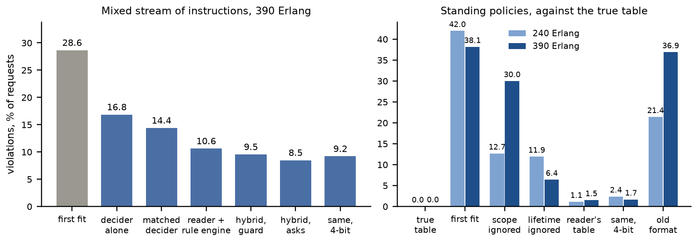

# Technical report — Operator instructions for lightpath provisioning with Apertus 8B

*Every number is copied from the results file named next to it. The long account of the first two
rounds is in `docs/report_rounds_1_2.md`; every result with its source file is in
`docs/results_overview.md`.*

- **Track:** Track 2B, own project: operator instructions for lightpath provisioning
- **Event:** Online
- **Team:** ApertusNetworkGym (Wadood Ranjha)
- **Demo:** TODO link to the video

## 1. Summary

Operators of optical transport networks state policy in plain language ("the Zurich–Milan span
is under maintenance", "for 400G services, avoid Basel until further notice"), in the language
they work in. We built a blueprint in which Apertus 8B reads such a policy while the network
still follows fixed, checkable rules. Apertus translates the sentence once into one line of a
small policy language; a rule engine enforces that line for every request the policy covers,
for as long as it holds. A second reader translates it again, and the operator is asked when a
request would be decided differently under the two readings. An instruction outside the
language goes to a fine-tuned Apertus that decides the request itself, with its choice checked
against the part the language carries. The line is also a TAPI 2.1.3 constraint, the object a
transport SDN controller takes. An operator console shows the network on a map with a feed of
what the model does: it reads back every policy, previews its effect on a copy of the network
before it is applied, names conflicts with the policies in force, pauses the stream to ask when
two readings would decide a request differently, and keeps an audit trail per lightpath.
Everything runs on a laptop GPU.

Measured in the Optical Networking Gym simulator on sentences written by separate AI instances
in four languages: the reader is right on 94.8 % of 2,078 instructions, on clause pairs it never
saw together as on trained pairs (96.5 against 95.6 %; triples three points lower); its decisions
comply in 99.6 %, those of the model that decides alone in 91.1 % (English probes), and 96.4 % when
that model is trained on the reader's own sentences: matched training data closes two thirds of
the gap offline, but in closed loop the matched decider still breaks 14.1 % of in-language
requests against the reader's 0.9 %. With scope and lifetime added, a reader trained on the
same recipe is right on 93.5 % of 800 blind policy sentences, and in closed loop the policy table
built from its readings breaks 1.1–1.5 % of requests against the true table, where ignoring
scope breaks 13–30 %, ignoring lifetime 6–12 %, first fit 38–42 %. On a mixed stream the hybrid
that asks breaks 8.5 % of requests (decider alone 16.8 %, first fit 28.6 %); asking only when a
request tells the readings apart puts 16 % fewer questions at the same error for the job
translator, and a third fewer for 0.35 points on the laptop hybrid. The fourth-format reader can
replace the third-format one, alone and in the hybrid, at the same error (hybrid 9.1 against
9.5 %), so one adapter serves both instructions and standing policies. The weak points are
measured too: the reader silently applies 47 % of instruction types no component was ever shown,
and the phrase "to Prague" is a scope to the new reader and a destination to the operator. The
4-bit laptop build, the one a judge can run, is one to four points weaker on every measure and is
reported beside the job figures throughout.

## 2. Architecture

```
operator policy ──> reader 1 ─┐  same reading, or no request   ┌─ in the language ──> policy table ──> rule engine ─┐
 (any language) ──> reader 2 ─┴─ tells them apart? ── yes ─────┤   (scope, lifetime, conflicts, report)             ├─> allocation
                                   │ no: ask (show the difference) └─ outside it / in part ───────────> decider (guarded) ┘
console: map, feed of the model's steps, read-back, TAPI constraint, preview on a copy of the network, questions, audit
request and network state ───────────────────────────────────────────────────────────────────────────────┘
```

- **Simulator** (`src/sim.py`): Optical Networking Gym, preset `jocn_benchmark` (nobel-eu, 28
  nodes, 41 links, five candidate paths per request, 320 slots, six modulation formats); a Swiss
  topology of 24 cities and 33 links (`data/topologies/swiss.xml`, built from public geography)
  loads through the same code. Each request is a **request view** (`src/view.py`).
- **Policy language** (`src/spec.py`): `avoid=Berlin-Prague,Paris; via=Lyon; hops=4; km=any;
  path=any; prefer=km,load; scope=rate:400; until=6h; rest=none`. Links and nodes to avoid, a
  node to pass through, limits, a candidate by number, preferences in order; **scope** (every
  request, a bit rate, requests from or to a node) and **until** (hours, or until withdrawn) make
  a sentence a standing policy. `rest=more` marks a part not carried; `unsupported` and
  `no_instruction` are the refusals; a name that is not a node makes the line *unresolved*.
- **Readers** (`src/translate.py`): Apertus 8B with a LoRA adapter, decoding under a grammar
  built from the node list (`src/grammar.py`); the same grammar as GBNF for llama.cpp.
- **Policy table** (`src/standing.py`): which policies are active, which cover a request, the
  one line they combine to (constraints add up, the tighter limit wins, the newest preference
  decides, older ones break ties), the conflicts a new policy raises (a node one policy requires
  and another avoids, two candidates by number, a node the avoided links cut off; an override of
  a preference), and a report per policy (requests covered, decisions changed, rejected).
- **Rule engine**: constraints filter the candidates (none left: reject), preferences apply in
  order. With a correct line it cannot break the policy.
- **Decider** (`src/policies.py`): Apertus 8B with another adapter answers `path=1 slot=120` or
  `reject`. **Guard:** a path that breaks the constraints the line carries is replaced.
- **TAPI** (`src/tapi.py`): the line as a `topology-constraint` and `routing-constraint` of TAPI
  2.1.3 (`exclude-link`, `exclude-node`, `include-node`, `max-allowed-hops`, `max-allowed-cost`,
  `route-objective-function`); what the standard cannot carry travels in `name` entries.
- **Console** (`src/console.py`, `make console`): one stream under standing policies and
  per-request instructions; a feed that narrates each step of the model (reading, agreement or
  question, decision, guard); the policy table with conflicts and a preview of each policy on a
  copy of the simulator; questions put by consequence with both routes; every decision judged
  against what was meant; the audit trail. An inspector opens any request: the five candidate
  paths, the constraint of the line that dropped each one, how the rest were ranked, and the
  spectrum the lightpath took. A race decides the evaluation's mixed stream by first fit, the
  decider, the reader and the hybrid side by side from the stored answers; at 390 Erlang, seed 1,
  the four replay their stored runs exactly (560, 329, 199 and 170 violations). The frontend is
  Svelte and TypeScript (`src/console_ui`), built inside the image. From recorded answers, or
  live behind llama.cpp.

### Target architecture (mandatory)

**a) On-premise**, and it runs **b) air-gapped**. At runtime the system is the network
controller (here the simulator), the policy table and one model server; nothing calls out. The
server holds one base model quantised to 4 bits (5.1 GB) and four adapters of 160 MB (two readers
of the third format, one of the fourth, the decider), switched per request. On a laptop with an
RTX 4060 (8 GB) under llama.cpp: 0.89 s per instruction, 0.97 s per decision
(`results/design/readers3.json`). A reader is called once per policy, not per request; the
decider only for instructions outside the language. The container built by `make run` needs no
network. A note on the host: with the adapters loaded llama.cpp held 7.3 GB of host RAM, and a
WSL VM of 7.8 GB left little for the simulator; the laptop runs were slowed by that, not by the
GPU.

## 3. Use of Apertus

- **Model:** `andreasmartin/apertus-v1.5-8b-text`, the text-only conversion of
  `swiss-ai/Apertus-v1.5-8B`; the organisers accepted it on Discord (7 Oct 2026) provided the
  fine-tuned weights are published and the procedure explained.
- **Four adapters** (QLoRA: 4-bit NF4 base, r = 32, α = 32, 79.7 M trainable parameters,
  completion-only loss; `src/train.py`): the decider on 12,000 simulator decisions (138 min); two
  readers of the third format on 5,570 instructions each (34 min each); one reader of the fourth
  format on 7,170 (65 min). A fifth, the **matched decider**, serves only the comparison: the
  decider's 12,000 states carrying reader 1's 5,570 training sentences (two epochs, 127 min).
  TODO: public links.
- **Decoding:** greedy, constrained to the decision line or the policy language.
- **Serving:** Transformers in Hugging Face Jobs (one A100) for training and scoring; llama.cpp
  with our own 4-bit GGUF of the base and GGUF adapters on the laptop; the rendered prompts are
  identical apart from the start token (`results/train/rendered_prompt3.txt`).
- **Apertus 70B** (both generations, 4-bit GGUF, 15 examples, no training) translated the same
  test instructions under the same grammar, and generation 1.5 served as the second reader.
- **Other models:** none is part of the system, and none produced a result. The brief allows
  other open-weights models to support development; we also used a closed one, Claude (Anthropic),
  and state its role exactly. It wrote code and documentation under the author's direction, the
  sentence templates of the readers' training data, and, as separate instances that never saw the
  repository or each other's output, the blind test sentences. It is not used at runtime, it never
  labelled a training example (every training line comes from the project's generators, which
  fill templates from the topology and know the line by construction), and it never judged an
  answer (scoring is exact comparison of lines; the simulator judges decisions). What rests on it
  is the wording of the sentences, and that is checked by 80 sentences written by people: the
  author's 40 and a contributor's 40 (§5).

## 4. Data

Synthetic, no personal data; licence CDLA-Permissive-2.0; the test sets with every reader's
answers are exported as a dataset with a card (`src/benchmark_export.py`, `data/benchmark/`:
4,770 instructions, 22 sets).

| Data | Size | How it was made |
| --- | --- | --- |
| Decider, training | 12,000 decisions | simulator episodes (seeds 101–106) labelled by rule-based teachers |
| Matched decider, training | 12,000 decisions | the same states; on 8,000 of them reader 1's training sentences, each where it is restrictive when it applies, labelled by the rule engine under its line (`src/decider3_data.py`) |
| Readers, training | 5,570 (third format), 7,170 (fourth) | templates in four languages filled from the topology; the fourth adds scope and lifetime clauses |
| Readers, test | 2,078 + 661 | 168 sentences per language by four separate AI instances from a brief naming the clause kinds and none of our wording |
| Standing policies, test | 800 | 200 scope and lifetime phrases by another separate instance, attached to the test sentences |
| Swiss network, test | 1,151 | the test sentences filled with Swiss cities in each language's own name (*Genf*, *Genève*, *Ginevra*) |
| Lines written by people | 40 + 40 | the owner: 35 English, 5 Urdu in Latin script; a contributor, from the project's template: 10 each in English, German, Italian, Swedish, 15 of them standing policies |
| Closed loop | 2 loads × 3 seeds × 2,000 requests | traffic seeds 1–3, never trained on; 4,599 distinct instructions; a second stream of standing policies |

Which clause combinations are trained (eight pairs) and which held out (seven pairs, five
triples), and four instruction types absent from all training, were fixed and committed before
any test sentence was opened (`7ab1e66`). A request is used for a test instruction when the
instruction is *restrictive* there: at least one feasible path complies and one does not.

## 5. Evaluation

**Protocol.** A decision *complies* when it lies in the set of paths the instruction allows;
with none allowed, only a reject complies. Closed loop: the no-intent teacher fills the network
for 1,000 requests, the policy decides 2,000; loads 240 and 390 Erlang, three seeds. Two
instruction-blind choices are scored everywhere: the first candidate that fits, and the decision
without an instruction. Tables: `results/tables/phase3.md`.

**Translate or decide** (`results/offline/*_probes3.json`, 672 English requests).

| | One clause | Pair seen | Pair never seen | Three clauses, never seen | All |
| --- | --- | --- | --- | --- | --- |
| Reader 1, right meaning, % | 94.6 | 95.6 | 96.5 | 91.2 | 94.8 |
| Apertus 8B, 15 examples, no training, % | 89.5 | 81.0 | 91.1 | 85.6 | 87.2 |
| Comply: first candidate that fits, % | 70.6 | 63.3 | 62.5 | 57.5 | 66.8 |
| Comply: decider alone, % | 96.2 | 90.6 | 85.7 | 76.2 | 91.1 |
| Comply: matched decider, % | 98.8 | 95.3 | 95.5 | 90.0 | 96.4 |
| Comply: reader 1 and rule engine, % | 99.4 | 100.0 | 99.1 | 100.0 | 99.6 |

The slots carry the composition; the decider loses ground with every clause, and part of that
was training: the first decider was taught the first round's four intents, not the third round's
clause kinds. The matched decider learned from the same states with reader 1's own training
sentences (`results/design/matched3.json`): it complies on 96.4 / 94.8 / 95.2 / 95.4 % (en / de /
fr / it) against 91.1 / 87.1 / 86.0 / 86.6 % for the first decider and 99.6 / 98.2 / 99.1 / 99.3 %
under reader 1's line, so the training data accounts for 62–70 % of the gap; a second epoch was
taken because the first scored 94.0 % on held-out decisions, under the 98 % fixed beforehand. On
types outside the language the two deciders are alike (new types 77.6 against 78.8 %). By language the
reader is right on 96.7 (en), 91.4 (de), 96.0 (fr), 94.8 (it) %. Apertus 70B with examples and
no training reaches 89.2 % (generation 1.5; the first 71.9 %): the fine-tuned 8B reads better
than a model nine times its size, as Qiu et al. (2022) found for compositional parsing.

**The gate and the second reader** (`results/design/readers3.json`; "left" = applied wrongly
although two readers were compared; in brackets the share asked).

| | Reader 1 alone | Left with reader 2 | Left with the untrained 8B | Left with the untrained 70B |
| --- | --- | --- | --- | --- |
| Policy language, applied wrongly % | 4.6 | 3.7 (2.8) | 1.5 (12.7) | 0.2 (13.4) |
| Types never shown to any component (253 sentences, hard and impossible variants included) | 46.6 | 16.2 (31.6) | 19.4 (44.7) | 0.0 (69.2) |
| Carried in part | 72.2 | 36.3 (50.9) | 33.0 (54.2) | 33.0 (53.3) |

A learned gate does not recognise what it was never shown. Two readers of one recipe share
most misreadings; a reader that differs catches more, which is what Hamidieh et al. (2026) report
for cross-model disagreement. The fourth-format reader (section on standing policies), trained
on the same recipe with 1,600 more sentences that carry an extra clause, silently applies only
16.7 % of the 108 never-shown sentences (reader 1: 46.3 %) and, as the check behind reader 1,
leaves 10.2 % of them at 38.0 % asked; inside the language, on the four-language pool, it leaves
2.0 % at 4.9 % asked where reader 2 leaves 3.7 % at 2.8 %: fewer silent errors for more questions;
one training run, so a lead, not a result. A third signal, five readings of reader 1
at temperature 0.8 (`results/design/consistency3.json`; all three signals measured on the laptop's
4-bit readers, the 70B from its job cache): asking when any sample differs from the greedy
reading leaves 3.5 % of the policy-language sentences wrong and unasked at 8.0 % asked
(reader 2 in 4 bits: 4.2 % at 5.4 %; the 70B: 0.6 % at 15.1 %), and 2.8 % of the never-shown types at 88.0 %
asked (reader 2: 8.3 % at 37.0 %). Disagreement among samples marks unfamiliar input more than it
marks error, as Cole et al. (2023) and Hamidieh et al. (2026) report, and costs five more readings,
each about one point worse than greedy (92.1 % against 93.1 % in the language); reader 2 or any
differing sample together leave 2.9 % at 10.1 % asked.

**Closed loop, mixed stream** (45 % in the language, 15 % unknown types, 10 % in part, 10 %
no instruction, 5 % places outside, 15 % none; `results/eval/*_mix3.json`), violations % of
requests at 390 Erlang, three seeds: first fit 28.6, decider alone 16.8, translator alone 10.6,
hybrid with guard 9.5, hybrid that asks 8.5 (asks for 8.9 % of requests), with the untrained 70B
as the check 8.3 (asks 24.1 %). Inside the language the hybrid breaks 0.8 %, on unknown types
28.9 %, and a better gate does not move the latter (28.3 %): the limit is what the decider can
follow. The matched decider alone breaks 14.4 % (inside the language 14.1 against 19.2 % for the
first decider; types never shown 29.0 against 27.9 %): in closed loop matched data closes only
28 % of the in-language gap to the reader. With the fourth-format reader in front, which passes
16.1 % of requests to the decider instead of 11.5 %, the hybrid breaks 9.1 % (9.7 % with the
matched decider; the reader alone 10.7 %), within the seeds' spread of the 9.5 % above; it still
breaks 31.2 % of the types never shown (third-format hybrid 31.6 %), because the decider fails on
them too (`results/eval/hybrid4_ft*_mix3.json`). Why the deciders do so much worse here than on the
probes (`results/design/decider_gap.json`, a replay from the answer caches): the probes put every
sentence where some path complies, while on 11.4 % of the stream's in-language requests none does
and only a reject complies; the matched decider takes a path on 93.5 % of those (the first decider
85.3 %, the rule engine 2.6 %), 10.65 of its 14.09 points. Where some path complies it breaks 4.7 %
(first decider 12.8 %, reader 0.8 %), as on the probes. Both deciders saw a reject in under 3 % of
their training examples. Figure 1 puts the two closed loops side by side.



*Figure 1. Violations in closed loop, three seeds: the mixed stream of instructions at 390 Erlang
(left) and the standing-policy stream judged against the true table (right); `results/eval/`.* **Asking by consequence** (`translate3_ft_askif-ft2`, both loads, one process): the
translator that always asks puts 397 questions and asks on 8.9 % of requests at 390 Erlang for
10.28 % violations; asking on the first request that tells the readings apart puts 332 (65 pairs
of readings were never told apart) and asks on 7.8 % for 10.25 %. On the laptop, with the 4-bit
models and the decider live, the hybrid that asks breaks 9.18 % (job: 8.47 %) with 225
questions; asking by consequence breaks 9.53 % with 152 questions (73 pairs never told apart),
asking on 7.4 % of requests instead of 9.6 %. The small cost has a cause: when both readers are
wrong in different ways, asking at once fixes the reading, asking by consequence only once the
two wrong readings diverge. The simulated operator answers with the truth, which an operator
shown two wrong readings cannot; with a **fair operator** who picks the right reading only when
one of the two is right and otherwise leaves the first (`translate3_ft_askfair-ft2`), the translator
breaks 10.3 / 10.7 % at 240 / 390 Erlang against 10.1 / 10.3 % with the truth and 10.5 / 10.6 %
without questions: inside the language the fair operator matches the truth (0.8 %), the rest of
the gain is the oracle's; of the 397 questions, 167 showed two wrong readings. The hybrid's gain from asking (9.5 to 8.5 %) was measured with the
truth only and is an upper bound.

**Standing policies** (`results/eval/*_standing4.json`). The fourth-format reader on the 800
blind policy sentences: right meaning, scope and lifetime included, 95.0 (en), 92.0 (de), 95.0
(fr), 92.0 (it) %; by kind, a bit rate 90–97.5, requests from a node 72.5–90 (the weakest), to a
node 92.5–100, a number of hours 90–100, until further notice 92.5–100. On the third round's
sets it is at least as good as reader 1 (96.7 / 93.2 / 96.0 / 94.6 %). In closed loop, policies
arrive (three at the start, one every two simulated hours, at most four active), hold for the
hours they state or until withdrawn, and cover the requests their scope names; every decision is
judged against the true table.

| Policy, violations % of requests | 240 Erlang | 390 Erlang | Rejected, % |
| --- | --- | --- | --- |
| The true policy table | 0.0 | 0.0 | 31.4 / 34.7 |
| First fit (ignores the policies) | 42.0 | 38.1 | 2.7 / 8.2 |
| True policies, scope ignored | 12.7 | 30.0 | 43.5 / 61.4 |
| True policies, lifetime ignored | 11.9 | 6.4 | 42.7 / 39.8 |
| Policies read by the fourth-format reader | 1.1 | 1.5 | 30.7 / 34.2 |
| The same reader in 4 bits on the laptop | 2.4 | 1.6 | 31.8 / 34.2 |
| Policies read by the third-format reader (no scope, no lifetime) | 21.4 | 36.9 | 52.0 / 68.1 |

The stream's policies are restrictive by construction (a third of requests are rejected under
the true table); what the ablations show is the cost of ignoring scope or lifetime, and the
reader's table stays within 1.5 points of the truth (per seed 0.9 / 0.0 / 2.4 and 0.0 / 4.4 /
0.1). The ablations swing with the seed, the reader's table does not: over ten seeds
(`results/eval/*_standing4_seeds10.json`) first fit breaks 41.9 ± 6.3 / 35.7 ± 4.6 %, scope ignored
23.2 ± 13.2 / 23.9 ± 18.0 %, lifetime ignored 19.5 ± 9.1 / 9.2 ± 5.2 %, the reader's table 1.0 ± 1.1 /
2.0 ± 2.1 % (worst seed 5.7 %), the true table 0.0 / 0.01 % (two needless rejects, the cost of its
own bookkeeping). A reader of the old format, which cannot read either slot, applies every policy to every
request for ever and rejects half to two thirds of them. In 4 bits on the laptop the
fourth-format reader is right on 90.6 % of the policy sentences (93.5 % in the job) and its table
stays within 2.4 points of the truth.

**A Swiss network and the author's lines.** On 1,151 sentences with Swiss cities in each
language's own name (*Genf*, *Genève*, *Ginevra*, *Sankt Gallen*; no reader ever saw them), reader 1
on the laptop is right on 90.6 (en), 92.0 (de), 90.8 (fr) and 89.0 (it) %, against 93.1 % on the
network it was trained on; one clause 92–97 %, three clauses 70–85 %
(`results/translate/translate3_ft_laptop_swiss.json`). In closed loop on that network at 600
Erlang (three seeds, `results/eval/*_mix3_swiss.json`; the laptop readers throughout) the
translator alone breaks 9.8 % of requests (2.2 % inside the language), the translator that asks
9.0 % (1.2 % inside the language; asked on 12.6 % of requests), asking by consequence 9.3 %
(asked on 8.0 %), first fit 24.7 %. The same laptop readers on the European network at 390 Erlang
(`results/eval/translate3_ft_laptop*_mix3.json`) break 1.9 % inside the language alone and 1.2 %
asking: the unseen city names cost 0.3 points alone and nothing once a second reader is asked.

**Lines written by people** (`results/design/owner.json`, `results/design/contributor1.json`; the
laptop readers, 4-bit base under llama.cpp). The author's 40 lines (35 English, 5 Urdu in Latin
script): reader 1 is right on 33, reader 2 on 35, the untrained 8B with 15 examples on 27, the
fourth-format reader on 31, and on 34 at 16 bits (an A100 job, the build of the main results). A contributor returned 40
lines from the project's template, 10 each in English, German, Italian and Swedish, 15 of them
standing policies: reader 1 is right on 20 of the 25 per-request lines, reader 2 on 22, the 8B on
16; the fourth-format reader on 21 of them and 14 of the 15 standing policies, 35 of 40 (German
10 of 10, English and Italian 9, Swedish 7; no reader saw Swedish in training), and at 16 bits on
36 of 40 (Swedish 9 of 10). The 16-bit build gets right some lines the laptop's misses (a routing
request outside the language flagged as such; "to munich" no longer read as a scope; a second
preference kept) and misses others (an avoided link dropped from a standing policy; "the second
route" left without a candidate number). With reader 2 as
the check, 5 of reader 1's 7 errors on the author's lines and 2 of 5 on the contributor's are
asked about. Errors that recur: a request's end point read as a waypoint or a scope ("go from
London to Lyon via Oslo", "to prague freom neighborsd but avoid berlin"; the language has no word for a request's own
end points); an ordinal written as its digit ("den andra rutten", the second route, as `path=2`,
where the template and the candidate list count from 0); *Wien* read as Warsaw by both
third-format readers and the 8B (the fourth-format reader got it right); a routing request outside
the language (a backup path, a fixed modulation, one contiguous block) applied as an empty line
instead of `unsupported`.

## 6. Limitations

- One topology in closed loop (the Swiss one offline so far), one traffic model, one simulator;
  the model ranks candidates the simulator has already checked, it does not compute physics.
- Every test sentence but 80 was written by an AI instance (40 by the author, 40 by one
  contributor, the only Urdu and Swedish); four languages otherwise, no Swiss German in
  the demo (72.7 % on a stress set).
- Unknown types remain the weak point (28–37 % violations for every policy in the mixed stream).
- The fourth-format reader has no second reader yet, so scope and lifetime are read once; the
  stream's policies are our construction and reuse the 800 sentences the reader is scored on;
  the scope and lifetime phrases were committed with the training templates, not before them;
  weekday and date phrases are not in the language.
- One training run per adapter (readers 1 and 2, same recipe, differ by 1.5 points, so smaller
  differences between readers sit inside seed noise); the simulated operator answers a question
  with the true meaning, so every gain from asking is an upper bound; the decider of the system
  was trained on the first round's intents; the matched decider removes most of that mismatch
  offline and little of the closed-loop gap, with one training run and one recipe (no larger
  decider, no longer training); combination and conflict rules of the table are our choices.
- The 4-bit laptop build loses 1.7 points on the third-format sets, most of it on composition
  (clause pairs never seen together 96.5 to 90.2 %, triples 91.2 to 83.8 %); the 70B ran from
  community GGUF builds; the TAPI object was not sent to a controller.
- The mixed stream's proportions are ours. From its per-kind rates the hybrid stays the best of the
  three policies for a share of unknown types between about 1 % and 42 % of requests
  (`docs/decisions.md`, 12 Oct), extrapolated, not measured; the simulated operator answers every
  question with the truth, so the gain from asking is an upper bound.

## 7. Reproducibility and cost

`make run` rebuilds every table from `results/` without a GPU and replays a laptop episode of
the hybrid; `make console` serves the console on port 8090. Every results file records the
command, the simulator commit (`f7c4491`), seeds and loads; every model answer is in
`results/cache/`; `docs/decisions.md` logs every deviation, mistake and its cost. Hugging Face
Jobs on one A100: about 20.7 GPU-hours and about USD 51.7 over four rounds and the follow-ups
(the fourth round USD 3.14; the matched decider and the fourth-format reader in the mixed stream
about USD 8.4; the lines written by people at 16 bits about USD 0.12).
The submission is the commit tagged `submission` in the repository.

## 8. Related work

LLMs now operate optical networks in testbeds and field trials: a locally fine-tuned 7B that
calls management APIs with a digital twin to pre-verify changes (Sun et al., JOCN 2025), an
agent with LLM-native, LLM-centric and rule-centric modes on a 440 km field link (Liu et al.,
JOCN 2026), and cross-vendor configuration by an RL-fine-tuned LLM (Wang et al., JOCN 2026). We add a compliance metric in closed loop on a
stream that includes what the model was never shown, a compositional held-out protocol with
instruction-blind baselines, and the cost of asking. Intent lifecycle, conflicts and reports are
what the standards ask for (ETSI ZSM 011; TM Forum IG1253, TMF921) and what surveys of
intent-based networking find missing (Gharbaoui et al., 2026); trust needs read-back and
verification (Jacobs et al., TNSM 2025). Asking by showing the difference follows Clarify
(HotNets 2025), which resolves ambiguity in configuration synthesis by differential
verification. Our compositional result matches Nandy (2026) and Qiu et al. (2022); the
second-reader result matches Hamidieh et al. (2026) on cross-model disagreement.

## 9. Next steps

A slot for a request's own end points; a second reader of the fourth format; policies with
calendar times; the TAPI object sent to a controller (TeraFlowSDN); instructions written by
operators; the Swiss network in closed loop.

## License

Creative Commons Attribution 4.0 (CC-BY-4.0). All HackApertus projects are open-sourced.

## References

- C. Natalino et al., "Optical Networking Gym: an open-source toolkit for resource assignment problems in optical networks", JOCN 16(12), G40 (2024).
- C. Sun et al., "Experimental demonstration of local AI-Agents for lifecycle management and control automation of optical networks", JOCN 17(8), C82 (2025).
- X. Liu et al., "Field trial of an LLM-powered AI agent for autonomous optical networks: a full-lifecycle demonstration", JOCN 18, A179 (2026), doi:10.1364/JOCN.575402.
- C. Wang et al., "Cross-vendor telecom optical network configuration automation from intentions: reasoning-enhanced and equipment-verified paradigm through an LLM", JOCN 18(10), 1042 (2026).
- M. Gharbaoui et al., "Assurance and conflict detection in intent-based networking: a comprehensive survey and insights on standards and open-source tools", arXiv:2603.23772 (2026).
- A. S. Jacobs et al., "Establishing trust for using natural language for intent-based networking", IEEE TNSM 22(5), 4775 (2025).
- R. Mondal, N. Bjørner, T. Millstein, A. Tang, G. Varghese, "Tackling ambiguity in user intent for LLM-based network configuration synthesis" (Clarify), HotNets (2025).
- L. Qiu et al., "Evaluating the impact of model scale for compositional generalization in semantic parsing", EMNLP (2022).
- A. Nandy, "Known intents, new combinations: clause-factorized decoding for compositional multi-intent detection", arXiv:2603.28929 (2026).
- K. Hamidieh et al., "Complementing self-consistency with cross-model disagreement for uncertainty quantification", ICLR (2026).
- ETSI GR ZSM 011; TM Forum IG1253 and TMF921; ONF TAPI 2.1.3 (TR-547).
